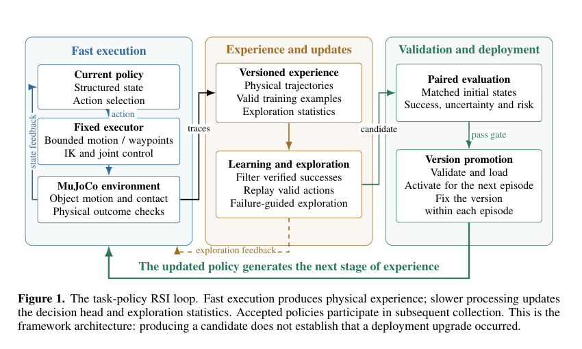
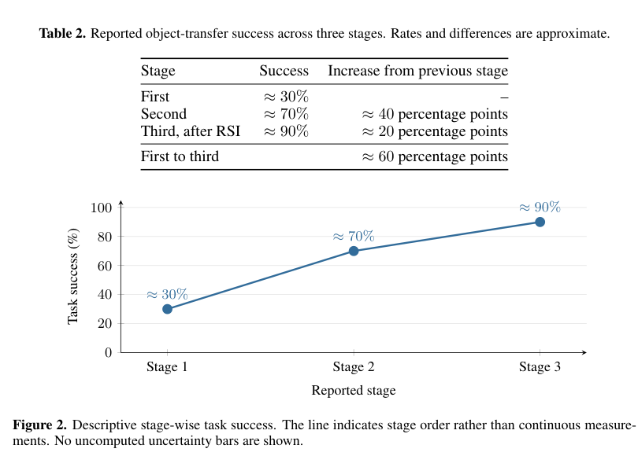
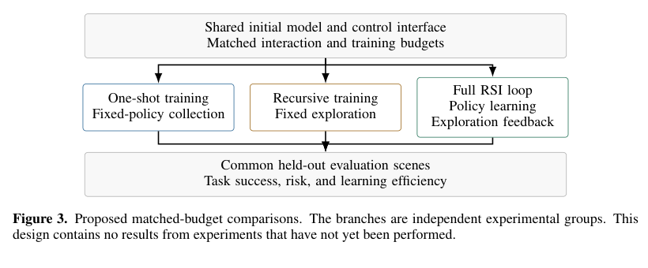

# Embodied-RSI: Recursive Policy Improvement through Autonomous Experience Feedback

> **Manuscript status and evidence boundary.** This is an illustrated reading guide to the supplied anonymous manuscript draft; the [original PDF](PAPER.pdf) is canonical. The approximate 30% → 70% → 90% success figures are preliminary stage observations from one simulated task. Complete counts, repeated runs, and matched-budget comparisons are not provided. The document does not establish conference acceptance, real-robot performance, or an isolated causal benefit of recursion.

## Research question

An individual action can look plausible while the robot still fails an entire pick-and-place sequence. Embodied-RSI asks how execution experience can support later task-policy updates without treating every recorded action as a valid training target. Its loop verifies physical outcomes, filters actions from successful episodes, uses failures to inform later exploration, trains a candidate policy, and validates that candidate before activation.

The paper defines **recursive self-improvement at the task-policy level**: a policy helps collect the data used to improve its successor. It does not claim that the learning algorithm itself improves automatically. The model version stays fixed during each episode; learning and deployment happen between collection stages.

## Task and decision interface

The primary task is to transfer an object into a plate. Completion requires stable grasping, lifting, transport, release into the target region, and end-effector withdrawal. Reaching the target or selecting a completion label alone is insufficient. MuJoCo supplies physical simulation; a policy reads structured state and selects among predefined actions; a fixed executor converts choices to bounded motion or skill waypoints; an independent checker determines episode success. Observations exclude terminal success labels, future returns, and teacher actions.

For stage `k`, the task policy `πθₖ` selects an action from those available in state `sₜ`. The episode record contains states, decisions, execution outcomes, a terminal success label, scene seed, policy version, and control configuration. Collection with accepted policy `πθₖ` and exploration memory `mₖ` produces stage data `Dₖ`. An updated candidate is used for later collection **only after validation**; candidate generation, acceptance, and activation are separate recorded events.

## Experience and learning loop

| Experience layer | Recorded information | Role |
| --- | --- | --- |
| Raw records | Complete trajectories, physical outcomes, and versions | Audit and failure localization |
| Training examples | Filtered state-action pairs with source identifiers | Decision-head learning and historical replay |
| Exploration statistics | Action attempts and failures in state buckets | Adjustment of later collection |

A successful episode does not make every action within it worth imitating. The paper uses a validity indicator to keep actions from verified successful episodes while excluding rejected actions, empty grasps, lost grasps, and transport choices made without a held object. Failed episodes can update exploration statistics but do not automatically become successful imitation examples.

The representation tower is frozen while the decision head is trained on current and historical verified examples. A lower replay loss is a training diagnostic, not a promotion decision. If no valid successful examples are available, an update can be skipped. Formal policy evaluation disables additional exploration memory and uses a consistent deterministic decision rule.

Training, development, release evaluation, and final audit use disjoint scene seeds. Development chooses a checkpoint; release evaluation compares that candidate with the accepted policy on matched scenes. The manuscript specifies a release gate of at least 90 independent pairs, a gain of at least five percentage points, a positive lower bound for a 95% paired-bootstrap interval, and checks for collisions, lost grasps, and rejected actions. **These are framework requirements; the manuscript says the original records are needed to confirm whether each reported stage met them.** A rejected candidate leaves the accepted version active.

## Reported stage observations

| Reported stage | Approximate complete-task success | Change from previous stage |
| --- | ---: | ---: |
| First | 30% | — |
| Second | 70% | +40 percentage points |
| Third, after RSI | 90% | +20 percentage points |

First to third is an approximate **60-percentage-point** increase. The first stage is not established as an untrained or zero-shot baseline. The figures describe stage order rather than continuous measurements, and no uncertainty bars are computed.

The later stages performed better in the reported simulation. These values alone cannot separate the effects of extra data, additional training, policy updates, or exploration changes. The PDF does not supply complete success/total counts, repeated runs, or stage budgets for uncertainty estimation and matched-budget inference. Action-level correctness, collection success, and replay loss are different from independent full-task success.

## Separate small-step control case study

A supplementary xArm7 simulation compares an apple-transfer task across three fixed initial positions, with a 160-cycle limit. Jev 1.13 completes 3/3 episodes, DeepSeek Flash with thinking disabled completes 0/3, and a rule-based controller completes 3/3. The corresponding control-cycle counts are 109/105/106, 160/160/160, and 106/104/102. These positions are small variations of one task, not independent task families; the result is a decision-stalling case study rather than a general robotics ranking.

Sixteen alternating identical-input request pairs yield median complete-request latencies of 0.359 seconds for Jev and 0.834 seconds for DeepSeek. These include network and service time, so they are not pure model-inference latency. Because DeepSeek does not finish the task, this is not a speedup measurement for successful task completion. **No policy training or version promotion occurs in this case study**, and its fine-grained direction interface differs from the primary framework's skill interface. It is excluded from the RSI learning curve.

## Comparisons proposed, not yet measured

The manuscript proposes a matched-budget evaluation of one-shot training with fixed-policy collection, recursive training with fixed exploration, and the full loop with policy learning plus exploration feedback. These groups would share initialization, control interface, scene distribution, and total interaction and training budgets. Further ablations would remove failure-informed exploration, invalid-action filtering, or historical replay. None of these proposed branches supplies a result in the current paper.

The paper also proposes measuring useful examples per attempted episode, interaction and acquisition cost to reach target success, and learning-curve area using cumulative interaction budgets. Stage labels alone cannot determine these efficiency measures. Recovery frequency, operator intervention, and time to successful completion are suggested deployment measures, **not observed cost savings**. A proposed active-acquisition extension is likewise unvalidated and does not explain the reported stage figures.

## Scope and limitations

The current evidence concerns one simulated manipulation task with structured state and a fixed executor. It does not establish visual perception, transfer to new tasks, or real-robot performance. Success-only imitation may underrepresent difficult states and may preserve accidental actions from rare successful episodes. Complete evaluation records, independent scenes, repeated runs, matched budgets, and recorded policy activations are needed to test the mechanism and its stability.

For the full methods, equations, original figures, and exact manuscript language, read the [PDF](PAPER.pdf).
